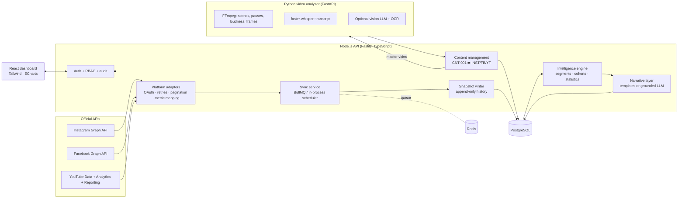
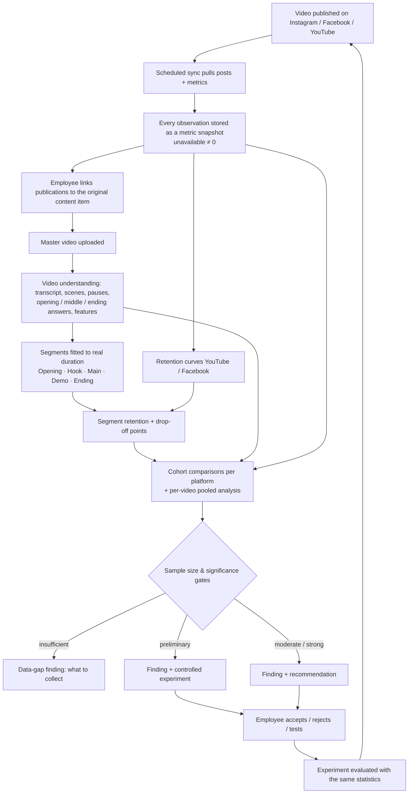
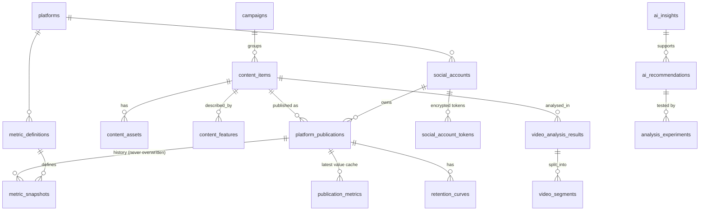

# Architecture — Phase 1

## System overview

## Data flow: from a published video to a recommendation

## Intelligence engine v2 — how a finding is produced

The engine answers four questions, and writes every answer twice: once in plain language for management and the content team, and once as the evidence an analyst can check.

**1. What happened in each video?** (`intelligence/curve.ts`)
The retention curve is reduced to the facts creative teams use:
- **hook**: how many viewers are still there after 3 seconds
- **hold**: a log-linear fit of the body of the curve, read as "loses x in 10 of the remaining viewers every 10 seconds"
- **halfway point**: when half the audience has gone
- **ending loss**: extra loss at the end, beyond the normal rate
- **shape**: one of *lost at the start*, *steady leak*, *drop in the middle*, *leaves before the end*, *healthy*

The steepest drop moments are matched to the transcript, pauses and scene cuts at that second ("At 0:14, about 2 in 10 left, while '…' was being said").
**Hook and hold are read together.** A good hook with poor hold means: fix the middle, not the opening.

**2. Was it good *for this kind of video*?** (`models.expectedModel`)
Each video is compared with what its own platform would predict for a video of that length, using its peers but not itself (leave-one-out). This gives a grade from A (well above expectations) to E (well below), so a small-account video is not called "bad" just because it got fewer views.

**3. What makes your videos work?** (`models.driversModel`)
- **Model:** one multivariate model per outcome: past 3 s, share watched, engagement (likes, comments, shares, saves), shares and saves. It is a ridge regression on content features (opening style, product in first 2 s, narration, editing pace, CTA, category, publishing time).
- **Controls:** platform, video length, publishing date and paid promotion, so it compares like with like.
- **Pooling platforms:** outcomes are standardised within platform before platforms are pooled.
- **Uncertainty:** a cluster bootstrap over original videos, so one video posted on three platforms counts once.
- **Many tests at once:** Benjamini–Hochberg false-discovery control across all findings of a run.
- **Warnings:** overlaps are flagged when two features always appear together.
- **Filtering:** effects too small to matter (more than 40 videos per variant needed to confirm) are dropped.
- **Small groups:** partial pooling (`shrinkGroups`) is used for small group averages.

**4. Where in the video do people leave, and why?** (`engine.contentRisk`)
Every second of viewer data is tagged: long explanation (spoken sentence of 14+ words), no voice, or just after a scene cut. Each video's loss rate in tagged moments is compared with **its own** untagged body, so audience size and platform cancel out. Results are reported as "viewers leave about twice as fast during long explanations".

**Portfolio findings**: most common curve problem per platform, CTA reach, the same video across platforms, trend over time, and data gaps.

**Plain-language layer** (`intelligence/plain.ts`):
- shares as natural frequencies ("3 in 10 viewers"), which non-specialists read more accurately than percentages
- ratios in words ("about twice as many")
- positions in words ("the weakest of 18 Facebook videos") instead of percentiles
- certainty as *strong evidence / good evidence / early signal / not enough data* with the number of videos, plus "publish about N videos each way to confirm" (Lehr's rule)

**Every finding** has a headline, what happened, likely reason, what to do, what it could be worth, how sure we are, and "show the evidence".

**Outputs**:
- **Executive brief** (`ai_briefs`): the short version, four numbers, what to do next, what works, what needs attention
- **Findings** (`ai_insights`)
- **Per-video report cards** (`/api/publications/:id/explain`, cached in `video_diagnostics`)
- **Recommendations and experiments**

The optional LLM may only rephrase a story. Any number not in the evidence makes it fall back to the template.

## Database (main entities)

Key rules enforced in the schema:
- `platform_publications (platform_code, platform_post_id)` is unique: a post is never duplicated.
- `metric_snapshots` has a unique index per publication/metric/period/hour, which prevents duplicates while keeping history.
- `availability` (`available | unavailable | not_supported | permission_missing | error`) is stored instead of fake zeros.
- `metric_definitions` maps canonical keys to each platform's own metric names, with versions and deprecation dates.
- `data_origin` (`live | demo`) separates demo data everywhere.
- **Adding LinkedIn** = insert into `platforms` + `metric_definitions`, then write `integrations/linkedin.ts` and register it. No schema change.

## Modules (blueprint § 9 → code)

| Blueprint module | Code |
|---|---|
| Authentication & user management | `apps/api/src/auth/auth.ts`, `routes/admin.ts` |
| Social account integrations | `routes/integrations.ts`, `integrations/tokens.ts`, `integrations/meta.ts` |
| Instagram / Facebook / YouTube adapters | `integrations/instagram.ts`, `facebook.ts`, `youtube.ts` |
| Data synchronisation service | `sync/syncService.ts`, `jobs/queue.ts` |
| Content management service | `routes/content.ts` |
| Analytics calculation | `routes/analytics.ts`, `intelligence/dataset.ts` |
| Historical metrics service | `sync/writer.ts` (append-only snapshots) |
| Video analysis service | `services/analyzer/*` (Python) + `services/videoAnalysis.ts` |
| AI intelligence service | `intelligence/engine.ts`, `explain.ts`, `stats.ts`, `segments.ts`, `narrative.ts` |
| Recommendation service | `engine.ts` (recommendations + experiments), `routes/insights.ts` |
| Reporting | dashboards + CSV export (`/api/export/content.csv`) |
| Audit & monitoring | `audit_logs`, `integration_logs`, `sync_jobs`, `/api/system/health` |

## Roles

| Permission | Admin | Marketing Manager | Content Creator | Viewer |
|---|:-:|:-:|:-:|:-:|
| Manage users, integrations, settings | ✓ | | | |
| View analytics & insights | ✓ | ✓ | ✓ | ✓ |
| All content / assigned content | ✓ / ✓ | ✓ / – | – / ✓ | ✓ / – |
| Edit content, correct AI features | ✓ | ✓ | ✓ | |
| Categories, campaigns | ✓ | ✓ | | |
| Run analysis | ✓ | ✓ | ✓ | |
| Review recommendations, experiments | ✓ | ✓ | | |
| Export | ✓ | ✓ | | |
| Audit log | ✓ | | | |
