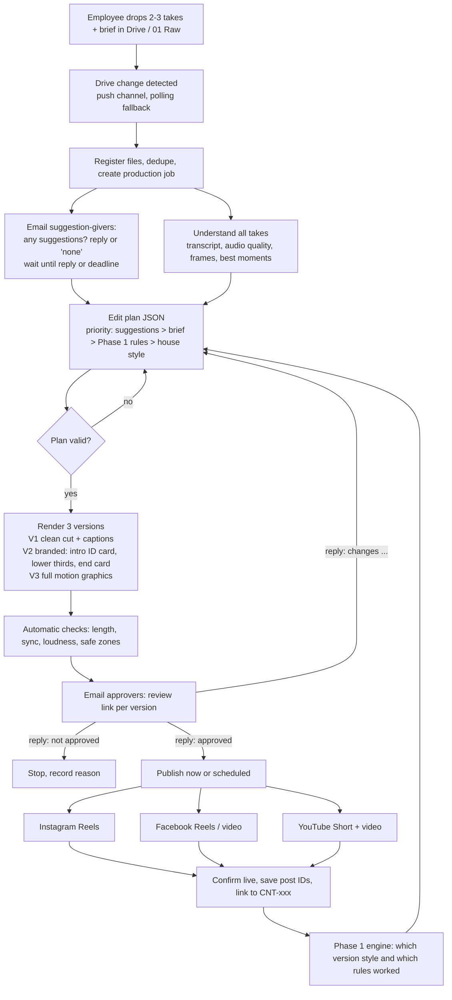

# Phase 2 plan: AI content production and automated publishing

**Goal:**
1. Employees shoot 2–3 takes of the same content and drop them in a Drive folder.
2. The platform asks the suggestion-givers for input.
3. It picks the best takes and builds three edited versions: clean cut, branded, and full motion graphics.
4. It emails the approvers a review link and reads their replies (approve / changes / reject).
5. It publishes to Instagram, Facebook and YouTube.

Every post links back to its content item, so the Phase 1 engine measures it, and its findings become editing rules for the next video.

Scope stays social only. There is no website, UTM or lead tracking.

## Can Claude edit video? (how it actually works)

Claude does not drag clips on a timeline. It **directs** the edit and **writes it as code**, and tools render it:

| Job | Who does it |
|---|---|
| Hear the speech | Whisper turns every take into a word-timed transcript. |
| Judge audio | Measured: loudness, background noise, clipping, long pauses, filler words. |
| See the picture | Claude looks at frames (sampled stills) from each take: framing, focus, eyes, whether the product is visible. The Claude API takes images, not video files, so frames are the route. |
| Pick the best take per line | Claude, using the transcript, audio scores and frames. |
| Edit plan | Claude writes it as JSON: clips, order, captions, graphics, music and timing. |
| Motion graphics | The edit plan lists the graphics (validated JSON); our own renderer draws them with skia: animated titles, 3D-style technical illustrations, diagrams, callouts, icons, counters, kinetic captions. |
| Cut, sync, level audio, render | FFmpeg (cuts, sound) + the studio renderer (skia + OpenCV, frame by frame). |

**Limits:**
- Claude cannot generate photorealistic photos or video footage. Pictures and B-roll come from your own photos and screenshots, or from free-licence stock (Pixabay, Pexels).
- Graphics are drawn shapes, text and icons, which is the clean "explainer" look.
- The first versions will need tuning. That is what the approval loop is for.

## Flow

## Decisions taken (Nov 2026)

| Topic | Decision |
|---|---|
| Google Drive | A personal Gmail for testing now. Switch to the company account once Phase 2 works. |
| Company size | Large, so the Remotion licence does not apply free. We built our **own renderer (skia + OpenCV + FFmpeg, all free licences)**: no headless browser, no licence fees, and Claude's output is data that is validated, not code that is run. |
| Suggestions | Before editing, the platform emails the people on a "Suggestions" list. Their suggestions override the engine rules. If one conflicts with a strong-evidence rule, we still follow the suggestion, but the review email says so and the engine later measures who was right. |
| Approval | Approvers are a list of emails set on the website. Each gets the review link by email and can reply in plain words: "approved", "not approved", or the changes. Claude reads the reply. Changes go back into the edit plan, and the revised version is emailed again. Unclear replies get a short follow-up question. Every decision is recorded with who and when. |
| Versions | Every video gets 4 versions: **A** clean cut + captions, **B** branded, **C** motion graphics in split screen (graphics on top, speaker below), **D** full-frame video with floating 3D graphics that swing in from the sides and never cover the face. All are reviewed; the approved one is published, and the engine learns which style performs best (`edit_style`). |
| Captions | Bottom of the frame, inside the platform's safe zone (above the Reels/Shorts buttons and caption area). Bold white text with a dark outline, the word being spoken highlighted yellow, 2 short lines maximum. Product names are spelled from a glossary. |
| Font and colours | House style chosen by us: Montserrat (headings and captions) and Inter (body), both free under the SIL Open Font License. Colours come from your logo. |
| Music | Licensed music only (see the music rules below). |

## What Phase 1 already gives us

- `content_items` (CNT codes) and `platform_publications`.
- Users, roles, audit log, and encrypted tokens for all three platforms.
- The job queue.
- The Python analyzer: transcript, scenes, silences, loudness.
- Engine findings in structured form, which become editing rules.

## Build order: 7 milestones

| # | Milestone | What gets built | Done when |
|---|---|---|---|
| M1 | **Drive intake + people lists** | Drive connection (personal Gmail, `drive.readonly`), the folder layout `01 Raw / 02 Working / 03 Pending approval / 04 Approved / 05 Published / Brand kit / References / Music`, change detection, and a brief form. Settings get a **Suggestions** email list and an **Approvers** email list, plus the rule "any one approver" or "all approvers". | Dropping 3 takes creates one job. Suggestion emails go out. |
| M2 | **Take selection** | Transcribe every take and line up the same sentence across takes. Score each line's audio (noise, loudness, clipping, stumbles, filler words) and picture (Claude on frames: framing, focus, eyes, product visible). Pick the best take per line. When lines from different takes are joined, hide the jump with a punch-in zoom or B-roll. If audio was recorded separately, sync it by waveform. | The job page shows the chosen take for each line, with the reason. |
| M3 | **Edit plan** | Claude writes the edit plan (JSON) for the 3 versions. Inputs, in this order: suggestions, brief, Phase 1 rules (for example "product on screen in the first 2 s"), reference style profile, house style. A validator checks timings and required parts. | The plan reads as plain steps and passes validation. |
| M4 | **Rendering** | FFmpeg: cuts, 9:16 reframing, audio at −14 LUFS, music ducked under speech. Studio renderer: animated captions, logo build, lower thirds, motion graphics, 3D illustrations, end card. Automatic quality checks. | One set of takes gives 3 versions × 2 formats (9:16, 16:9) that play correctly. |
| M5 | **Email approval** | Send email from the connected Gmail (Gmail API) with a link per version: a Drive file shared view-only with the approvers, so the platform does not need to be online yet. Read replies in the same thread. Claude classifies each reply and extracts the requested changes. Optional Approve / Request changes buttons once the platform is hosted. | A reply "make the logo bigger and cut the first 3 seconds" produces a revised version, which is emailed again. |
| M6 | **Publishing** | Instagram, Facebook and YouTube publishing, scheduling in our database, duplicate guard, retries, and a manual fallback pack. | Publishing to a test account works end to end, already linked to its CNT code. |
| M7 | **Close the loop** | The engine compares versions (clean vs branded vs motion graphics) and checks each editing rule. Rules that work stay, and rules that don't get dropped. | The brief shows which edit style wins, with certainty labels. |

## Music rules (licensed only)

- **Allowed sources:**
  - **Pixabay Music:** free, commercial use, no attribution. Skip tracks marked "Content ID Registered", and save the licence certificate for every track.
  - **YouTube Audio Library:** check each track's licence before using it off YouTube.
  - **Meta Sound Collection:** for Instagram/Facebook-only versions.
  - A paid library (Uppbeat, Epidemic Sound) if the company prefers guaranteed clearance on all platforms.
- **Never** use Instagram's or TikTok's general music library on a business account, or any commercial song.
- **Enforcement:** the platform only uses tracks in `Drive / Music` that have a licence file next to them. A track without proof cannot be selected.

## Permissions and limits

- **Meta:** add `instagram_content_publish`, `pages_manage_posts` and `publish_video`.
  - 100 API posts per 24 hours per Instagram account (check `content_publishing_limit`).
  - Containers expire after 24 hours.
  - API Reels are reportedly capped at about 90 s, so we keep Reel versions under that.
- **YouTube:** add `youtube.upload`. Uploads from an unaudited project are locked to private, so the audit has to be requested early. About 6 uploads a day on the default quota.
- **Google:** add `drive.readonly`, `gmail.send` and `gmail.readonly`. These are restricted scopes: fine for your own personal Gmail behind the "unverified app" screen, and for the company account use an Internal (Workspace) consent screen.
- **Claude API:** used for take selection (frames), the edit plan, motion-graphics code and reading replies. Expected cost is roughly tens of cents per video.

## Risks

| Risk | Handling |
|---|---|
| A bad edit | Human approval is mandatory, there are 3 versions to choose from, and every choice has a stated reason. |
| Captions invent product claims | Captions come from the transcript, and on-screen claims only from the brief. Anything else is flagged. |
| Music claims or mutes | Licensed sources only, licence file required, certificate kept for disputes. |
| Reference videos copied | Only style is measured (pace, caption style, cut rhythm). No reference footage or audio is reused. |
| Ambiguous approval reply | Claude asks one follow-up question and never publishes on an unclear reply. |
| Double posting | Idempotent per version and platform. |

## Still needed from you

1. The company logo (for the brand kit).
2. The Suggestions and Approvers email lists, and whether "any one approver" is enough.
3. One sample set of 2–3 raw takes to build and test with.

## Built (Nov 2026) — status

| Milestone | Status | Where |
|---|---|---|
| M1 Drive intake + people lists | Built. Drive & Gmail connect in Integrations; folders are created automatically; a folder in "01 Raw footage" becomes a video once uploads finish. | `apps/api/src/integrations/workspace.ts`, `studio/intake.ts` |
| M2 Take selection | Built and tested on 3 takes (one with "uh", one noisy, one missing lines). Word timings are tightened from the audio. | `services/analyzer/studio/takes.py` |
| M3 Edit plan | Built: rules from Phase 1 findings, suggestions first, change requests as safe operations, optional Claude for graphics. | `studio/planner.py`, `directives.py`, `llm.py`, `apps/api/src/studio/rules.ts` |
| M4 Rendering | Built: 3 versions, captions white + yellow, logo build (vector redraw of the company logo), split layouts, 3D illustrations, music ducking, −14 LUFS, QC. Parallel rendering. | `studio/render.py`, `graphics.py`, `illustrations.py`, `captions.py` |
| M5 Email approval | Built: suggestion and approval emails with preview images and Drive links; replies read every minute; one approver is enough; replies from other addresses are ignored. "Test a reply" box in the app. | `studio/pipeline.ts`, `emails.ts` |
| M6 Publishing | Built: Instagram Reels, Facebook Reels, YouTube (resumable). Falls back to "post by hand" with the reason. Needs reconnecting Meta/YouTube for the new publish permissions. | `studio/publish.ts` |
| M7 Close the loop | Built: published posts link to the content item; `edit_style` and `ai_edited` features feed the engine; the final video is analysed like any other. | `publish.ts`, `intelligence/engine.ts` |
| Dashboard | Built into the Phase 1 app: Content Studio section (dashboard, new video, review & approve, music library, studio settings). | `apps/web/src/pages/studio/*` |
