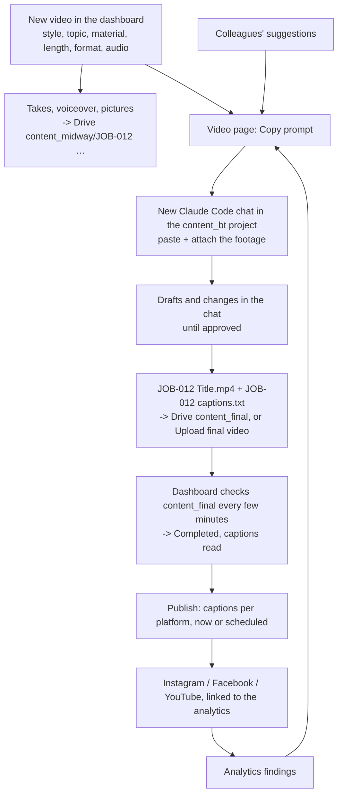

# Phase 4: videos edited by Claude Code (8 Nov 2026)

**Status:** built and tested. Replaces the automatic rules editor/renderer (Phase 2) and the Claude API director (Phase 3).

## Why
The Claude API costs money per video. The team already has Claude Code, which can edit a video in a chat. So the dashboard now:
- sets the video up
- writes the prompt
- keeps the material in Google Drive
- picks up the finished video
- publishes it

The edit itself happens in a Claude Code chat. There are no API keys and no per-video token cost.

## The flow

Stages on the Studio dashboard: **Prompt ready → Editing with Claude → Ready to publish → Published**.

## What was built
| Part | Where |
|---|---|
| 8 preset styles (spec, looks, best for, good to know, example topic) | `apps/api/src/studio/presets.ts` |
| Live previews of each style (SVG animations) | `apps/web/src/pages/studio/StylePreview.tsx` |
| Styles page: presets + "copy the style of a video you like" (reference video kept in Drive, measured locally) | `StudioStyles.tsx`, `services/analyzer/studio/style_extract.py` |
| New video form (style, topic, material, storyboard, length, format, audio, details, machines) | `StudioNew.tsx` |
| The prompt (brief, style spec, brand, Drive links, suggestions, findings, delivery names, captions format) | `apps/api/src/studio/handoff.ts`, `pipeline.ts › promptContext` |
| Video page: Copy prompt, finished video, publish, set-up, material, suggestions | `StudioJob.tsx`, `Publish.tsx` |
| content_final scan: job code match, import of other videos, captions file, set-aside files never picked up again | `pipeline.ts › scanFinals` |
| content_raw intake: a folder with takes / voiceover / brief.txt (Style:, Length:, Format:) becomes a video | `intake.ts` |
| Publishing from the finished file, "I posted it" for manual posts | `publish.ts`, routes |
| Drive backfill of the logo, reference videos, machine photos and music made before | `pipeline.ts › backfillDrive` |
| Migration | `db/migrations/012_claude_code_handoff.sql` |
| How Claude builds the edits | `docs/EDITING_GUIDE.md` (also a project doc) |

## Removed
- **Claude API:** director, style cards, machine modelling, take scoring, reply reading, frame descriptions, LLM narratives, settings, cost and budget.
- **The automatic editor:** take selection, planner, renderer, 3D engine and assets, storyboards.
- **Approval:** approval in the dashboard and by email, Gmail.
- **Database:**
  - tables `production_versions`, `approval_decisions`, `email_threads`, `email_replies`, `studio_assets`
  - the `studio.approve` permission
  - the old job columns

Backups made before the change: `_backups/before_claude_code_handoff_2026-11-08.tar.gz` (code) and `_backups/database_pgdata_before_handoff_2026-11-08.tar.gz` (database).

## Tests (8 Nov 2026)
- Typecheck of API and dashboard.
- API tests: 40 passed, including 13 new prompt / captions / intake tests.
- Python: 4 passed.
- Migration 012 run on a copy of the real database:
  - 3 published videos kept
  - unfinished videos moved to *Prompt ready*
  - settings, reference style and machines kept
- `node scripts/e2e-studio.mjs`: 63 of 63 checks, covering:
  - every API and page
  - the 8 presets
  - reference style
  - machine
  - new video with take and picture uploaded to Drive
  - the prompt contents
  - Copy prompt
  - content_final linking, import and captions
  - content_raw intake
  - Upload final video
  - publish with "post by hand" and "I posted it"
  - cancel, reopen and "Make changes"
- Screens checked in a browser: dashboard, styles, style detail, new video, video page, prompt, publish, completed, settings.

## Templates and thumbnails (8 Nov 2026, second part)
- Each preset now sends its **full prompt template** (`apps/api/templates/studio/*.md`, from the user's templates; Paper Cut-Out written to match). Section 1 is filled by the dashboard (topic, storyboard, voiceover, subtitles, length, format, sound). The prompt is: section 0 (this job, how to build here, our footage and logo) → the template → the hand-off (material, brand, words, suggestions, findings, what to deliver).
- Template review, fixed in the wrapper: they said "do not use Claude Code" (removed); they assume no camera footage (section 0 explains); browser MediaRecorder export is unreliable, so the MP4 is rendered frame-exact; Paper Cut-Out was missing; no thumbnail, captions or file naming (added in the hand-off).
- **Simple Edit** (preset 9): footage only, clean cuts, picture and sound; music, sound effects and subtitles off by default.
- **Subtitles** option on every video.
- **Thumbnails** (migration 013): Claude's `JOB thumbnail.jpg` from content_final → else an automatic frame (FFmpeg `thumbnail` filter) → change it by upload or a chosen frame. Takes get frames too. Shown on the dashboard rows, Completed cards, video page, publish form and content library. Used when publishing: Instagram `cover_url` (signed public link, only with a public https `API_PUBLIC_URL`) or `thumb_offset`; Facebook `/{video}/thumbnails`; YouTube `thumbnails.set` (verified channel needed).
- Tests: API 46 passed; Python 4 passed; `e2e-studio.mjs` 74 of 74 (9 presets, template prompt, Simple Edit prompt, take frames, Claude / automatic / uploaded / frame thumbnails, signed cover link).

## Style packs and the end of reference styles (8 Nov 2026, third part)
- The "Styles from your reference videos" section is removed from the Styles page and from New video (it needed Claude to read the video; here that is done in a chat). The backend for reference styles is left in place, so videos made earlier in a reference style still work.
- **Style packs** (migration 014): a new style is added from the dashboard with no code change, so it works after deploying. A pack is `style.json` + `template.md` + a thumbnail + an optional README, made by Claude from a video you like (`docs/ADD_A_STYLE.md`) and added in **Styles & music → Add a style pack**. It is stored in the database, shows on the Styles page and in New video with its picture, can be replaced by adding it again, and deleted when no video in progress uses it.
- Code: `packFormat.ts` (checks), `packs.ts` (database and list), routes `/api/studio/style-packs`, `StudioStyles.tsx`. A footage-only pack is treated like Simple Edit in the prompt.
- Tests: `test/packs.test.ts` (8) and 8 new checks in `scripts/e2e-studio.mjs` (add, list with picture, serve the picture, refuse an incomplete pack, replace, prompt from the pack template, delete refused while in use, delete after). Example pack: `docs/style-pack-example/`. **`docs/STYLE_PACK_KIT.md`** is the single file to attach (with the video) to a Claude chat on any account to get a pack: instructions, tested ffmpeg/Python analysis commands, the rules for each file, the checker `scripts/check_style_pack.py` and the example pack inside it. The checker agrees with the dashboard's check on 42 test packs; 4 more tests keep the kit identical to the real files.

## Later
- Write the finished video to content_final straight from the chat when the Drive connector allows uploads of large files.
- Optional: a small editing toolkit (transcribe / render-frames / compose scripts) kept in the project, so every chat starts from the same helpers.
